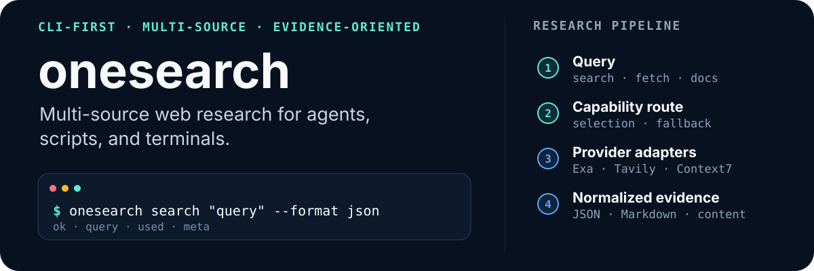

<p align="center">
  <a href="README.md">English</a> · <a href="README.zh-CN.md">简体中文</a>
</p>

<p align="center">
  
</p>

<p align="center">
  <a href="https://github.com/deqiying/onesearch/actions/workflows/npm-publish.yml"></a>
  <a href="https://www.npmjs.com/package/onesearch"></a>
  
  <a href="LICENSE"></a>
  <a href="https://linux.do/"></a>
</p>

`onesearch` 是面向 AI agent、脚本和终端用户的 CLI-first 研究与证据工具，统一答案搜索、来源发现、文档检索、网页抓取、站点 map/crawl、仓库 Wiki、离线研究规划、配置诊断和内置 Skill 分发。

> 可用 `skills show` 读取工作流并执行 CLI，也可用 `onesearch mcp` 接入本地 stdio MCP Server。MCP 已在源码实现，npm 清单版本 `1.0.6` 尚不包含本功能；发布前使用本地构建 binary，包含本功能的版本发布后可用 `npx -y onesearch mcp`，详见 [MCP 接入指南](docs/guides/mcp.md)。

## 为什么使用 onesearch

- **显式路由**：任务 → 能力路由 → provider 选择 / fallback → 统一结果。
- **面向 agent 与脚本**：版本化命令合同、严格参数解析、紧凑 JSON 和内置 Skill。
- **发现与证据分离**：候选 URL 不等于已验证正文；形成结论前应抓取关键来源。
- **凭据脱敏**：覆盖动态输出与输出文件；`deep` 只做离线规划，不调用 provider。

## 快速开始

以下示例使用 PowerShell。npm 提供 Windows x64、Linux x64 和 macOS arm64 二进制，其他构建见 [GitHub Releases](https://github.com/deqiying/onesearch/releases)。

```powershell
npm install -g onesearch
onesearch --version
onesearch schema search --format json
onesearch status --format json --pretty
```

`schema` 离线且不创建配置；`status` 会初始化缺失的配置。首次 `ready: false` 并不表示安装失败。完整搜索需要答案、文档检索与页面抓取能力，例如：

```powershell
onesearch config setup openai-compatible
onesearch config setup exa
onesearch status --format json --pretty
```

交互提示会隐藏 API key。确认 `minimum_profile.ok == true` 后再执行：

```powershell
onesearch search "解释 Go context cancellation 的常用模式" --validation balanced --format json
```

只研究公开仓库时，也可以在 `capabilities.repo_wiki.ok == true` 后独立使用默认启用的 DeepWiki，无需先配齐完整搜索 profile。readiness 是本机 preflight，不保证远端可达。详细步骤见[上手指南](docs/guides/getting-started.md)。

## 能力地图

搜索与证据链、文档、站点、仓库和 provider-direct 命令见 [CLI 参考](docs/reference/cli.md)。

## 配置

默认配置为 `~/.config/onesearch/config.json`，可用 `ONESEARCH_CONFIG_DIR` 覆盖。凭据输入、路由、profile、adapter 限制见[配置参考](docs/reference/configuration.md)和 [config.example.json](config.example.json)。

## 将 onesearch 接入 agent

按 [Agent 接入指南](docs/guides/agent-integration.md)安装薄入口 Skill，由实际运行的 binary 提供版本匹配的工作流，不在 host 中复制 provider 合同。

需要原生 MCP tools 而不是执行 CLI 时，按 [MCP 接入指南](docs/guides/mcp.md)配置 host。服务仅通过 stdio 提供 5 个工具；在 MCP 外配置 provider，用 `onesearch_status` 检查各 operation readiness。发布、真实 host 与 live provider 验收尚待完成。

## 开发

构建与测试见[开发指南](docs/guides/development.md)，模块边界见[架构概览](docs/architecture/README.md)。

## 文档

从[文档导航](docs/README.md)进入当前使用手册；设计原因、原始方案与替代关系单独保存在[设计决策记录](docs/decisions/README.md)，不作为当前操作手册。

以上相对链接面向仓库检出。Release 压缩包仅附带英文 README 与许可证，完整文档请访问 [GitHub 仓库](https://github.com/deqiying/onesearch)。

## License

本项目采用 [Apache License 2.0](LICENSE)。
