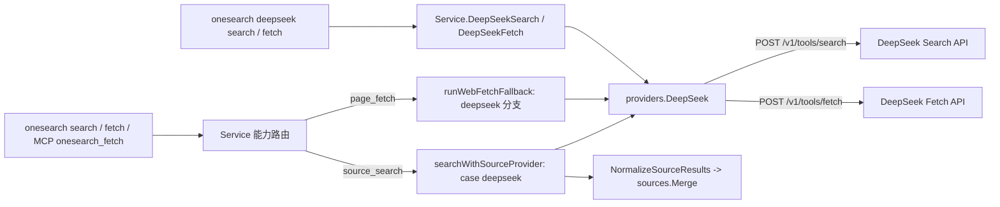

# DeepSeek Search / Fetch Provider 接入技术方案

> 设计记录：保留 DeepSeek Search / Fetch 接入的原始协议依据、取舍与本地验证结果。摘要、背景中的“当前”指实施前基线；当前能力以[CLI 参考](../reference/cli.md)和[配置参考](../reference/configuration.md)为准，实现见 [DeepSeek adapter](../../internal/providers/deepseek.go)。返回[设计记录导航](README.md)。

## 文档状态

- 状态：已实施（本地验证完成；真实 Search / Fetch live 调用已验证，402、429 未触发）。
- 基线日期：2026-10-20。
- 实施日期：2026-10-20。
- 代码基线：`bf838d31df9c198b34f80f48ebe36c2f81c61a90`（版本 `1.0.7`）。
- 适用范围：新增 `deepseek` provider，接入 `source_search`、`page_fetch` workflow 路由，并提供 provider-direct 命令与内置 Skill。
- 外部参考：[网页搜索与抓取指南](https://api-docs.deepseek.com/zh-cn/guides/search)、[Search API Reference](https://api-docs.deepseek.com/zh-cn/api/search)、[Fetch API Reference](https://api-docs.deepseek.com/zh-cn/api/fetch)，均于基线日期读取。

## 摘要

DeepSeek 新增两个原始 JSON 工具接口：`POST /v1/tools/search` 按 query 返回结构化网页结果，`POST /v1/tools/fetch` 抓取单个 URL 并返回 Markdown。二者与 DeepSeek API 使用相同的 Bearer 鉴权，按成功请求次数计费，每个账号各自限速 5 QPS。

两者的能力形态分别对应 onesearch 现有的 `source_search`（结构化来源发现）和 `page_fetch`（单页正文抓取）。上游不生成模型答案，因此不进入 `answer_search`。

本方案采用以下结论：

1. 新增 provider `deepseek`（adapter `deepseek_tools`），声明 `source_search` 与 `page_fetch`；默认 `enabled: false`，API key 读取 `DEEPSEEK_API_KEY`，base URL 为 API 根路径 `https://api.deepseek.com`。
2. 不修改 `defaultRuntimeRoutes`，依靠现有 capability 自动追加机制将 `deepseek` 放在两条 route 的末段。新旧配置得到相同顺序；用户显式启用前，现有行为不变。
3. 新增 provider-direct 叶子命令 `onesearch deepseek search` 与 `onesearch deepseek fetch`，参数与上游字段一一对应，不发明 flag 到搜索语法的转换。
4. 在 `searchWithSourceProvider` 与 `runWebFetchFallback` 中新增 `deepseek` 分支，复用现有 fallback、attempt 与来源归一化链路。MCP `onesearch_fetch` 经 `page_fetch` route 自动获得该 provider，MCP 代码不改。
5. adapter 在本地校验 query 长度、count 范围、URL 形态等上游硬约束，非法请求不发出。错误按 HTTP 状态码归一化，修正 402/403/404 在默认映射下的误分类，并让 workflow attempt 保留真实 `error_type`。
6. 不在 adapter 内重试、限流或按 `rerank_score` 过滤；408/429/5xx 交给现有跨 provider fallback 与调用方处理。
7. 新增 `onesearch-deepseek` 内置 Skill；实施完成后同步 CLI/配置参考、上手指南与 Agent 接入指南的中英文页面。

## 背景

### 需求理解

“新增端点并纳入现有工具集”在 onesearch 中对应三层接入：

| 层 | 含义 | 本方案落点 |
| --- | --- | --- |
| Provider 定义 | runtime 可配置、可诊断、可 setup 的 provider | `deepseek` 定义、`config setup deepseek`、`status` / `doctor` |
| Workflow 路由 | `search`、`fetch` 与 MCP 通过 capability route 选择 provider | `source_search`、`page_fetch` 分支 |
| Provider-direct | 显式指定上游接口的叶子命令 | `deepseek search`、`deepseek fetch` 与对应 Skill |

`answer_search`、`docs_search`、`site_map`、`site_crawl`、`repo_wiki` 与上游能力不对应，不在本次范围内。

### DeepSeek 上游合同

| API | Endpoint | 请求体 | 成功响应 |
| --- | --- | --- | --- |
| Search | `POST https://api.deepseek.com/v1/tools/search` | `query`、`count`、`ori_question`、`localization`、`need_content` | `{"results": [...]}` |
| Fetch | `POST https://api.deepseek.com/v1/tools/fetch` | `url` | `{"title": "...", "content": "..."}` |

请求头为 `Authorization: Bearer <DeepSeek API Key>` 与 `Content-Type: application/json`。请求体中的未知字段会被**静默忽略**，因此字段名拼写错误不会触发 400，只能由 payload fixture 测试发现。

Search 请求字段：

| 字段 | 类型 | 必填 | 默认 | 约束 |
| --- | --- | --- | --- | --- |
| `query` | string | 是 | — | 1–128 个 Unicode 字符，不能全为空白；支持搜索语法 |
| `count` | integer | 否 | `10` | 1–50 |
| `ori_question` | string | 否 | — | 1–128 个字符；`null` 视为未提供 |
| `localization` | string | 否 | `""` | 用于优先返回本地化结果的 IP 地址 |
| `need_content` | boolean | 否 | `false` | 为 `false` 时 `content` 恒为空字符串 |

`query` 中的搜索语法原样传给搜索服务，支持 `site:`、`-site:`、`-关键词`、`-"短语"`、`"精确短语"`、`lang:zh,en`、`after:`、`before:`，可组合使用。

Search 结果字段：`rerank_score`（0–3，≥1.5 为优质）、`title`、`url`、`snippet`（100–200 字符，面向前端展示）、`summary`（600–800 字符，面向模型阅读）、`content`（正文，按 `need_content` 返回）、`site_name` / `site_icon` / `date`（均可为 `null`，`date` 为 UTC RFC 3339）、`authority`（0–4，`-1` 表示未知，≥3 为极权威）。无匹配结果时返回空数组。

Fetch 的 `url` 不超过 8192，必须是含 host 的 HTTP/HTTPS URL，且不能携带用户名或密码。响应中的 `title` 缺失时为空字符串，`content` 为 Markdown 正文。

错误响应使用 OpenAI 兼容格式 `{"error": {"message", "type", "code", "param": null}}`，状态码语义如下：

| HTTP | 上游语义 | 上游建议 |
| --- | --- | --- |
| 400 | 请求头或请求体不合法 | 不修改请求时勿重试 |
| 401 | API Key 缺失或无效 | 勿重试 |
| 402 | 账号余额不足 | 充值后重试 |
| 403 | Fetch 请求被安全策略拒绝 | 勿重试 |
| 404 | Fetch 未获取到可用网页内容 | 勿重试 |
| 408 | 读取请求体超时 | 等待后重试 |
| 413 | 请求体超过大小限制 | 勿重试 |
| 429 | 超过 Search 或 Fetch 的 QPS 限制 | 等待后重试 |
| 500 / 504 | 服务器内部错误 / 下游请求超时 | 等待后重试 |

计费与限速：

- Search 与 Fetch 各按每 1,000 次成功请求 5 元计费。只有 HTTP 200 且有结果（Search 的 `results` 非空、Fetch 返回正文）才计费，`count` 不影响单价。
- 指南另行说明：在 DeepSeek Harness、Claude Code、Codex 中通过 server 端工具调用访问 Search/Fetch 的部分，将于 2026-11-01 起计费。按该段表述，这一日期仅针对模型对话中的 server 端工具；onesearch 直接调用 `/v1/tools/*` 属于普通按次计费请求。此为对文档表述的推断，未经计费账单验证。
- 每个账号的 Search 与 Fetch 各限 5 QPS，与 API Key 和模型并发无关；Fetch 另有按目标域名的 QPS 限制，超限均返回 429。

### 当前 onesearch 接入链路

```text
onesearch search --extra-sources N / --validation strict
  -> execution.Execute("search") -> Service.Search
  -> extraSources / runWebSearchFallback
  -> searchWithSourceProvider（按 provider.ID switch 分派）

onesearch fetch <url> / search --fetch-sources N / MCP onesearch_fetch
  -> Service.Fetch / fetchSourceCandidates
  -> runWebFetchFallback（按 provider.ID if 链分派）

onesearch <provider> <leaf>
  -> runParsedProvider（按 definition.ID switch）
  -> Service.<Provider><Op> -> providers.<Provider>
```

关键代码事实：

- [`internal/config/runtime.go`](../../internal/config/runtime.go) 的 `defaultProviders()` 定义内置 provider，`supportedAdapters` 限定可用 adapter。`routesWithProviderCapabilities()` 会把声明了 capability 但未出现在 route 中的 provider **按 ID 字母序**追加到 route 末尾，`settings.direct_only=true` 的除外。`providerAvailability()` 在无 key 且未设置 `anonymous_allowed` 时返回 `missing_api_key`。
- [`internal/service/service.go`](../../internal/service/service.go) 的 `searchWithSourceProvider()` 和 `runWebFetchFallback()` 按 provider ID 硬编码分派，未知 ID 返回 `unsupported source_search provider` / `unsupported page_fetch provider`。Exa、Zhipu、AnySearch 等分支把 provider 结果 map 中的 `error` 字符串包装成 `fmt.Errorf("%s", ...)`，`ErrorPayload()` 因此只能回落到 `network_error`；Tavily、Firecrawl 分支直接返回带类型的 error。
- [`internal/providers/types.go`](../../internal/providers/types.go) 的 `PostJSON()` 统一设置 `Content-Type`、`Accept`、`User-Agent`，响应读取上限 4 MiB。`ErrorPayload()` 优先使用上游 `error.type` 经 `normalizeProviderErrorType()` 的字符串匹配结果。`NormalizeSourceResults()` 的 `firstString()` 只判断值是否为 string，不判断是否为空。
- [`internal/service/provider_direct.go`](../../internal/service/provider_direct.go) 与 `Service.ZhipuSearch()` 等 HTTP provider 的 direct 方法只检查 key，不检查 `enabled`；agent 侧通过 Skill 要求先满足 `direct_endpoints.<provider>.available`。
- [`internal/commandcontract/providers.go`](../../internal/commandcontract/providers.go) 的 `providerDefinitions()` 与 `providerNamespaces()` 定义 provider-direct 命令。`OptionDefinition` 已支持 `Minimum` / `Maximum`，CLI parser 与 `input_schema` 都会执行和输出该约束，但目前尚无命令使用；位置参数只支持 `MinLength`。
- [`internal/cli/command_bindings.go`](../../internal/cli/command_bindings.go) 要求 `commandBindings` 数量与 registry 一致，否则在 `init` 时 panic。[`internal/cli/provider_commands.go`](../../internal/cli/provider_commands.go) 的 `direct_endpoints` 和 provider tool alias 均由 registry 派生。
- [`internal/config/provider_setup.go`](../../internal/config/provider_setup.go) 的 setup 是通用逻辑：未设置 `anonymous_allowed` 即要求 key，`base_url` 非空即支持 `--base-url`。
- [`internal/mcpserver/dispatch.go`](../../internal/mcpserver/dispatch.go) 将 `onesearch_fetch` 的 `provider` 透传给 `fetch` workflow，并在 MCP 层校验 URL 为不含 userinfo 的 HTTP(S)；`onesearch_search` 的 `sources` 模式固定使用 `exa.web-search`。
- [`internal/skills/skills.go`](../../internal/skills/skills.go) 注册内置 Skill。[`skills_test.go`](../../internal/skills/skills_test.go) 锁定 Skill 数量，并要求每个 Skill 文档化其所有 canonical `onesearch schema <path> --format json` 命令。

## 问题定义

只在 `defaultProviders()` 中增加一项并不能完成接入，存在以下问题：

1. **分派缺口**：provider 会经自动追加进入 route，但 service 没有对应分支。启用后每次调用都会记录一次 `unsupported ... provider: deepseek` 的 error attempt。
2. **来源描述被遮蔽**：`need_content=false` 时上游 `content` 恒为 `""`。若直接把原始 item 交给 `NormalizeSourceResults()`，`firstString(item, "description", "content", "snippet", "text")` 会命中空 `content` 并返回空串，来源失去描述。
3. **错误语义丢失或误判**：沿用 `fmt.Errorf("%s", data["error"])` 会让 attempt 全部变成 `network_error`。即使保留 `HTTPError`，默认映射也会把 Fetch 的 403（URL 被策略拒绝）归为 `auth_error`，误导调用方去检查凭据；402 与 404 则会回落到 `network_error` 或原样泄出上游 type 字符串。
4. **输入约束不匹配**：上游 `query` 最多 128 个 Unicode 字符，而 workflow 收到的 query 可能是更长的自然语言问题。`ori_question` 的约束是 1–128，发送空字符串本身就是非法请求，必须省略该字段。
5. **费用与凭据**：DeepSeek 按成功请求计费，而 `DEEPSEEK_API_KEY` 常被 chat、agent 类工具预先设置。若默认 `enabled: "auto"`，用户升级后可能在 fallback 链中静默产生费用。
6. **Base URL 习惯**：DeepSeek chat 用户常配置 `https://api.deepseek.com/v1`。直接拼接 `/v1/tools/search` 会得到 `/v1/v1/tools/search`。

## 目标

1. `deepseek` 作为 `source_search` 与 `page_fetch` provider 可配置、可诊断，并支持 `config setup deepseek`。
2. `search --extra-sources`、`search --validation strict`、`search --fetch-sources`、`fetch --provider deepseek` 与 MCP `onesearch_fetch` 能正确使用 DeepSeek，并进入现有 attempt、fallback、`used` 与来源合并输出。
3. 提供 `onesearch deepseek search` 与 `onesearch deepseek fetch`，暴露上游全部请求字段，出现在 manifest、`status.direct_endpoints` 与 Skill 中。
4. 请求 payload 与上游合同精确一致；违反上游硬约束的请求在本地返回 `parameter_error`，不发出网络请求。
5. 错误类型按上游状态码语义归一化，direct 输出与 workflow attempt 均保留该类型。
6. 已有用户配置无需迁移；显式启用前不发起任何 DeepSeek 请求。

## 非目标

1. 不新增 `answer_search` adapter，也不对接 DeepSeek chat 模型的 server 端工具调用。
2. 不把 DeepSeek 加入 `docs_search`、`site_map`、`site_crawl`。
3. 不调整 Exa、Zhipu、Tavily、Firecrawl 等现有 provider 的 route 优先级，也不改变 MCP `onesearch_search` 的 `sources` 固定 Exa 行为。
4. 不提供 `--include-domains`、`--lang`、`--after` 等 flag 到搜索语法的转换，搜索语法由调用方写入 query。
5. 不在 adapter 内实现重试、客户端 QPS 限流、费用统计或按 `rerank_score` / `authority` 过滤与重排。
6. 不自动探测或填充本机 IP 作为 `localization`。
7. 不扩展命令合同框架，例如为位置参数新增 `MaxLength`。
8. 不修改 mock smoke 场景与 `regression` 固定输出。

## 总体设计



### 设计原则

- 与 Zhipu、Tavily 同构：一个 provider 文件封装 wire、校验与归一化；service 层只负责构造 client、路由和 workflow 适配。
- adapter 分两层 API：workflow 使用返回 `(data, error)` 的方法，direct 命令使用返回 provider envelope 的 `*Result` 方法。这与 Tavily 的 `Search/SearchResult`、`Extract/ExtractResult` 一致，避免把错误类型降级为字符串。
- 上游硬约束在本地校验并快速失败，软语义（搜索语法、排序、打分）原样透传。
- 失败进入现有 provider fallback，不在 adapter 内隐藏重试或回退。
- 默认关闭，用户显式启用后才可能产生费用。

## Provider 与配置合同

### Provider 定义

| 字段 | 值 | 说明 |
| --- | --- | --- |
| provider ID | `deepseek` | CLI namespace、route、filter 与 setup 标识 |
| adapter | `deepseek_tools` | 新增常量 `AdapterDeepSeekTools` 并加入 `supportedAdapters`，命名对应 `/v1/tools/*` wire 族 |
| capabilities | `source_search`、`page_fetch` | 与上游 Search、Fetch 一一对应 |
| `base_url` | `https://api.deepseek.com` | 新增常量 `DefaultDeepSeekAPIURL`，语义为 API 根路径 |
| `api_key_env` | `DEEPSEEK_API_KEY` | 与 DeepSeek 官方示例及常见工具一致 |
| `enabled` | `false` | 见下节 |
| `settings` | `{"timeout_seconds": 30}` | 与其他 HTTP provider 一致 |
| aliases | 无 | 避免与现有 ID / alias 冲突，provider ID 已足够短 |

`config.example.json` 按现有条目格式增加：

```json
"deepseek": {
  "enabled": false,
  "adapter": "deepseek_tools",
  "capabilities": [
    "source_search",
    "page_fetch"
  ],
  "base_url": "https://api.deepseek.com",
  "api_key": "",
  "api_key_env": "DEEPSEEK_API_KEY",
  "settings": {
    "timeout_seconds": 30
  }
}
```

### 默认禁用

默认 `enabled: false` 的理由：

- 上游按成功次数计费，`--extra-sources` 与 page_fetch fallback 都可能在用户无感知时调用末段 provider。
- `DEEPSEEK_API_KEY` 往往已为 chat 或 agent 用途设置。若默认 `auto`，升级后会因 key 存在而自动变为可用。
- 与 Exa、Zhipu、Tavily、Firecrawl 等付费 provider 的默认值一致。

`config setup deepseek` 会按现有逻辑把 `enabled` 写为 `"auto"`，视为用户显式启用。

### 路由位置

不修改 `defaultRuntimeRoutes()`，由 `routesWithProviderCapabilities()` 自动追加。无论是新安装（`InitialRuntimeSchema()` 持久化默认 routes），还是未自定义 routes 的已有配置，有效顺序都相同：

| capability | 有效 fallback 顺序 |
| --- | --- |
| `source_search` | `exa` → `zhipu` → `tavily` → `firecrawl` → `deepseek` |
| `page_fetch` | `tavily` → `firecrawl` → `anysearch` → `deepseek` → `exa` |

自定义 routes 的用户同样获得自动追加，可通过编辑 `routes` 或 `--source-providers deepseek`、`--fetch-providers deepseek`、`fetch --provider deepseek` 显式提升优先级。

备选方案是在 `defaultRuntimeRoutes()` 中显式写入 `deepseek`。不采用的原因：

- 新安装会持久化包含 `deepseek` 的 routes，而已有配置仍按自动追加排序，导致新旧安装的 `page_fetch` 顺序不同（`deepseek` 分别排在 `anysearch` 之前和之后）。
- 与 Exa、AnySearch 在 `page_fetch` 上依赖自动追加的既有做法不一致。
- 持久化的 route 引用新 provider ID 后，回退到旧版本 binary 时会多出 `unknown_provider` 诊断。

### 凭据与 setup

- `ResolveProviderSetupFromRuntime()` 已能推导 `RequiresAPIKey=true`、`SupportsBaseURL=true`，setup 代码无需修改，只需补充测试。
- `api_key` 优先于 `api_key_env`，沿用现有凭据解析与 `OutputSecretValues()` 脱敏逻辑，不新增 secret 字段。
- direct 方法与现有 HTTP provider 一致，只检查 key；`enabled` 只控制 workflow 路由。direct 调用属于显式选择，agent 侧由 Skill 要求先满足 `direct_endpoints.deepseek.available == true`。

## 协议合同

### Endpoint 与 base URL

| `base_url` | Search 目标 URL |
| --- | --- |
| `https://api.deepseek.com` | `https://api.deepseek.com/v1/tools/search` |
| `https://api.deepseek.com/` | `https://api.deepseek.com/v1/tools/search` |
| `https://api.deepseek.com/v1` | `https://api.deepseek.com/v1/tools/search` |
| `https://relay.example.com/deepseek` | `https://relay.example.com/deepseek/v1/tools/search` |
| `https://api.deepseek.com/v1/tools/search` | 拒绝，返回 `config_error`，不发请求 |

规则：去除首尾空白与末尾 `/`。路径以 `/tools`、`/tools/search` 或 `/tools/fetch` 结尾时拒绝；以 `/v1` 结尾时追加 `/tools/<op>`；否则追加 `/v1/tools/<op>`。无法解析或 scheme 不是 HTTP(S) 时同样返回 `config_error`。Fetch 使用相同规则。拒绝完整 endpoint 的做法沿用 [Alpha Search 方案](openai-responses-alpha-search-technical-design.md#endpoint)。

### Headers

复用 `PostJSON()`，最终请求头为：

```text
Authorization: Bearer <api-key>
Content-Type: application/json
Accept: application/json
User-Agent: onesearch/<version>
```

不发送 OpenAI 或 Responses 专用头。

### Search 请求

```go
type DeepSeek struct {
    APIURL  string
    APIKey  string
    Timeout time.Duration
}

type DeepSeekSearchOptions struct {
    Count        int
    NeedContent  bool
    OriQuestion  string
    Localization string
}

type deepSeekSearchRequest struct {
    Query        string `json:"query"`
    Count        int    `json:"count"`
    OriQuestion  string `json:"ori_question,omitempty"`
    Localization string `json:"localization,omitempty"`
    NeedContent  bool   `json:"need_content"`
}
```

目标请求示例：

```json
{
  "query": "DeepSeek 模型 site:github.com OR site:huggingface.co lang:zh after:2025",
  "count": 10,
  "need_content": false
}
```

提供可选字段时：

```json
{
  "query": "DeepSeek V4 发布",
  "count": 5,
  "ori_question": "DeepSeek V4 是什么时候发布的？",
  "need_content": true
}
```

字段规则：

- `query`：去除首尾空白后不得为空，rune 数不超过 128（按 Unicode 字符计，不按字节）；否则返回 `parameter_error`。发送 trim 后文本，搜索语法不改写、不转义。
- `count`：必须在 1–50 之间，始终显式发送，不依赖上游默认值。
- `need_content`：始终显式发送布尔值。
- `ori_question`：为空时省略字段，不发送空字符串；非空时同样执行 1–128 rune 校验。
- `localization`：为空时省略；非空时用 `net.ParseIP` 校验，非法返回 `parameter_error`。该值只来自调用方，不写入输出与诊断。
- 不发送上游未定义的字段。上游会静默忽略未知字段，因此必须用 fixture 对完整 payload 做 `DeepEqual`。

### Search 响应归一化

解析规则：

1. 2xx 响应体必须是 JSON object，且 `results` 必须存在并为数组；否则返回 `upstream_error`。2xx 时的 JSON 解码失败（包括超过 `PostJSON()` 4 MiB 上限导致的截断）也归为 `upstream_error`，消息提示减小 `count` 或关闭 `need_content`。
2. `results` 为空数组是合法结果。direct 返回 `ok: true, total: 0`，与 Zhipu、Exa、Tavily 一致；workflow 记录为 `empty` attempt 并继续 fallback。
3. 保持上游顺序，不按 `rerank_score` / `authority` 过滤或重排。
4. `null` 或空字符串字段省略，不输出 `"null"` 字符串。

字段映射：

| 上游字段 | 归一化字段 | 规则 |
| --- | --- | --- |
| `title` | `title` | 原样 |
| `url` | `url` | trim |
| `snippet` | `description` | 非空时优先作为描述 |
| `summary` | `summary`；`snippet` 为空时也作为 `description` | 保留长摘要供模型阅读 |
| `content` | `content` | 仅在 `need_content=true` 且非空时输出 |
| `site_name` | `source` | 与 Zhipu 的 `media → source` 一致 |
| `site_icon` | `icon` | 与 Zhipu 一致 |
| `date` | `published_date` | 保留 RFC 3339 原文 |
| `rerank_score` | `rerank_score` | 原样数值 |
| `authority` | `authority` | 原样，`-1` 表示未知 |
| — | `provider` | 固定为 `deepseek` |

显式写入 `description` 并在 `content` 为空时省略该键，可避免问题定义第 2 条中 `firstString()` 被空 `content` 遮蔽。`description` 选用短摘要，使 workflow 来源保持“待核验候选”的紧凑定位；长摘要仍在 direct 输出的 `summary` 中。

### Fetch 请求与响应

```json
{"url": "https://example.com/article"}
```

本地校验，失败时返回 `parameter_error` 且不发请求：

- 去除首尾空白后非空，长度不超过 8192 个字符；
- `url.Parse` 成功，scheme 为 `http` 或 `https`，host 非空；
- 不含 userinfo，以免把 URL 中的凭据发给第三方。

响应规则：

1. 2xx 响应体必须是 JSON object，`content` 必须为 string，否则返回 `upstream_error`。
2. `content` trim 后为空时返回 `empty_result`（direct 为 `ok: false`）。与 Tavily extract、Firecrawl scrape 的空正文语义一致；按上游计费规则，这类响应也不应计费。
3. `title` 可为空字符串，原样保留。
4. 不截断 `content`，与 Tavily、Firecrawl 的 workflow 分支一致；长正文由输出层的 compact 预览处理。

### 错误映射

adapter 对 `PostJSON()` 返回的 `*HTTPError` 按状态码改写 `ProviderType`，保留 `StatusCode`、`RetryAfter` 与上游 `error.message`，不依赖上游 `error.type` 的字符串匹配。改写后的值经 `normalizeProviderErrorType()` 原样通过。

| HTTP | 接口 | `error_type` | 退出码 | 说明 |
| --- | --- | --- | --- | --- |
| 400、413 | 两者 | `parameter_error` | 2 | 修改请求后再试 |
| 401 | 两者 | `auth_error` | 5 | 检查 key |
| 402 | 两者 | `provider_error` | 5 | 消息标明余额不足，不应自动重试 |
| 403 | Fetch | `provider_error` | 5 | 消息标明被安全策略拒绝，**不是**凭据问题 |
| 403 | Search（文档未定义） | `auth_error` | 5 | 沿用默认语义 |
| 404 | Fetch | `empty_result` | 5 | 目标页不可用或无可提取正文 |
| 408、504 | 两者 | `timeout` | 5 | 可等待后重试 |
| 429 | 两者 | `rate_limited` | 5 | 账号或目标域名 QPS 超限 |
| 500、502、503 | 两者 | `upstream_error` | 5 | 可等待后重试 |
| 其他 | 两者 | 沿用 `ErrorPayload()` 默认 | — | — |

补充规则：

- 错误消息格式为 `DeepSeek <search|fetch>: <upstream message> (HTTP <code>)`，长度沿用现有 500 字符截断，不包含 API key、请求头或 `localization`。
- context 取消与传输超时沿用 `ErrorPayload()` 的 `timeout` / `network_error` 判定。
- workflow 中所有错误都会继续尝试下一个 provider（`--fallback off` 时只尝试第一个），与现有循环语义一致。

## 命令与 workflow 合同

### `onesearch deepseek search`

| 参数 | 类型 | 默认 | 约束 | 上游字段 |
| --- | --- | --- | --- | --- |
| `query`（位置参数） | string | — | 必填；1–128 字符，由 provider 校验 | `query` |
| `--count` | integer | `10` | 1–50，使用 `Minimum` / `Maximum` 写入 schema | `count` |
| `--need-content` | boolean | `false` | — | `need_content` |
| `--ori-question` | string | `""` | 空则省略；非空时 1–128 字符 | `ori_question` |
| `--localization` | string | `""` | 空则省略；IP 地址 | `localization` |

```go
providerCommand("deepseek.search", "deepseek", []string{"deepseek", "search"}, "Search the web with DeepSeek.", []string{"source_search"},
    []PositionalDefinition{positional("query", "Search query (1-128 characters); search operators are passed through.", true)},
    []OptionDefinition{
        {Name: "count", Flag: "count", Type: TypeInteger, Default: 10, HasDefault: true, Minimum: &deepSeekCountMin, Maximum: &deepSeekCountMax, Description: "Number of results."},
        optionDefault("need_content", "need-content", TypeBoolean, false, "Include page body text in results."),
        optionDefault("ori_question", "ori-question", TypeString, "", "Original user question used to interpret search intent."),
        optionDefault("localization", "localization", TypeString, "", "IP address used to prefer localized results."),
    }),
```

`Minimum` / `Maximum` 需要 `*float64`，可在 `providers.go` 中声明包级变量或局部 helper，不修改 `fragments.go` 的公共 helper。CLI parser 与 `NormalizeInput()` 对越界值统一返回 `parameter_error`，provider 层仍做防御性校验。

### `onesearch deepseek fetch`

| 参数 | 类型 | 约束 | 上游字段 |
| --- | --- | --- | --- |
| `url`（位置参数） | string | 必填；HTTP(S)、含 host、无 userinfo、不超过 8192 字符 | `url` |

```go
providerCommand("deepseek.fetch", "deepseek", []string{"deepseek", "fetch"}, "Fetch one URL as Markdown with DeepSeek.", []string{"page_fetch"},
    []PositionalDefinition{positional("url", "Target URL.", true)}, nil),
```

命令名直接沿用上游接口名 `search` / `fetch`，与 `zhipu search`、`tavily extract`、`firecrawl scrape` 跟随上游命名的惯例一致。`commandBindings` 的 HandlerKey 为 `deepseek_search`、`deepseek_fetch`，输出中的 `tool` 字段相同；`providerNamespaces()` 增加 `deepseek`。registry 公共命令从 45 个增至 47 个，manifest version 保持 `2`。

### 输出示例

`deepseek search`：

```json
{
  "ok": true,
  "provider": "deepseek",
  "tool": "deepseek_search",
  "query": "DeepSeek V4 模型 发布",
  "results": [
    {
      "title": "DeepSeek V4 模型发布",
      "url": "https://example.com/deepseek-v4",
      "description": "DeepSeek V4 已上线，支持工具调用与长上下文。",
      "summary": "DeepSeek 发布了 V4 模型……",
      "source": "Example News",
      "icon": "https://example.com/favicon.ico",
      "published_date": "2026-06-01T00:00:00+00:00",
      "rerank_score": 2.4,
      "authority": 3,
      "provider": "deepseek"
    }
  ],
  "total": 1,
  "elapsed_ms": 812.4
}
```

`deepseek fetch`：

```json
{
  "ok": true,
  "provider": "deepseek",
  "tool": "deepseek_fetch",
  "url": "https://example.com/article",
  "title": "Example article",
  "content": "# Example article\n\nArticle content.",
  "elapsed_ms": 640.2
}
```

`--format content` 沿用输出层对 `content` 字段的处理，直接输出 Markdown 正文；默认 compact JSON 仍可能把长正文替换为 `content_preview` / `content_length`。

### Workflow 接入

`searchWithSourceProvider()` 新增分支：

```go
case "deepseek":
    raw, err := providers.DeepSeek{APIURL: provider.BaseURL, APIKey: provider.APIKey, Timeout: durationSeconds(provider.SettingFloat("timeout_seconds", 30))}.
        Search(ctx, truncateRunes(strings.TrimSpace(query), 128), providers.DeepSeekSearchOptions{Count: clampInt(count, 1, 50)})
    return providers.NormalizeSourceResults(raw, "deepseek"), err
```

`runWebFetchFallback()` 新增分支，由 `Fetch()` 返回 `(DeepSeekPage, error)` 并取 `Content`。

适配规则：

- **query 截断**：workflow query 超过 128 rune 时，在 service 层按 rune 截断并再次 trim，与 Zhipu `bigmodel_cn` 截断到 70 rune 的先例一致。provider 层保持严格校验，direct 命令遇到超长 query 直接报错，不截断。
- **count 收敛**：`extraSources` 与 `runWebSearchFallback` 计算出的 count 收敛到 1–50。
- **字段**：workflow 不发送 `need_content`（显式为 `false`）、`ori_question` 和 `localization`。正文证据由 `page_fetch` 负责。
- **错误类型**：两条分支直接返回带类型的 error，attempt 的 `error_type` 与 direct 输出一致。
- **费用可见性**：`extraSources` 会把 count 分摊给全部可用的 source provider，并在剩余数量大于 0 时继续调用后续 provider。`deepseek` 位于末尾，只在前序 provider 未满足 count 时被调用。`runWebSearchFallback` 与 `runWebFetchFallback` 在首个成功 provider 处停止。
- **MCP**：`onesearch_fetch` 的 `provider: "deepseek"` 与 auto 路由在启用后自动生效，`onesearch_status` 的 `fetch` readiness 同步反映；`onesearch_search` 的 `sources` 仍为 Exa。

## Skill 与文档同步

新增 `internal/skills/assets/onesearch-deepseek/`：

- `SKILL.md`：front matter 的 `name: onesearch-deepseek`，description 覆盖“显式使用 DeepSeek 搜索、需要 `site:`/`lang:`/`after:`/`before:` 等搜索语法、DeepSeek 单页 Markdown 抓取”。正文需包含：
  - `onesearch schema deepseek search --format json` 与 `onesearch schema deepseek fetch --format json`（`skills_test.go` 强制要求）；
  - `status.direct_endpoints.deepseek.available == true` 的 preflight；
  - 搜索语法与组合示例，`rerank_score ≥ 1.5`、`authority ≥ 3` 的含义；
  - 按次计费、5 QPS 与结果属于候选的提醒；
  - 恢复规则：402 不重试；429/408/5xx 等待后最多重试一次或改用其他 provider；Fetch 403/404 改用其他 `page_fetch` provider。
- `agents/openai.yaml`：`display_name`、`short_description`，以及包含 `$onesearch-deepseek` 的 `default_prompt`。

注册与引用：

- `skills.go` 增加 `{ID: "deepseek", Folder: "onesearch-deepseek", Aliases: []string{"deepseek-tools", "deepseek-search", "deepseek-fetch"}, Capabilities: []string{"source_search", "page_fetch"}, ...}`。别名不与现有 `deep`（deep-research）冲突。
- router `onesearch/SKILL.md` 的路由表增加一行“Explicit DeepSeek search with query operators, or DeepSeek page fetch → `onesearch-deepseek`”。
- `onesearch-search`、`onesearch-fetch` workflow Skill 保持 provider 中立，不修改。

实施完成后同步当前文档（未实施前不改）：

| 文档 | 同步内容 |
| --- | --- |
| [CLI 参考](../reference/cli.md) / [English](../reference/cli.en.md) | 能力地图的 `source_search`、`page_fetch` 加入 DeepSeek；provider-direct 示例；协议边界（128 字符、按次计费、base URL 为 API 根） |
| [配置参考](../reference/configuration.md) / [English](../reference/configuration.en.md) | 默认禁用列表加入 DeepSeek；adapter 限制说明 |
| [上手指南](../guides/getting-started.md) / [English](../guides/getting-started.en.md) | `page_fetch` 可选 provider 加入 DeepSeek |
| [Agent 接入](../guides/agent-integration.md) / [English](../guides/agent-integration.en.md) | provider Skill 列表加入 DeepSeek |
| [设计记录导航](README.md) | 本文状态更新为已实施，并记录验证边界 |

根 README、npm README 与 MCP 指南不列举 provider 清单，不需要修改。

## 源码组织

```text
internal/providers/
  deepseek.go        # client、endpoint 归一化、请求校验、响应归一化、错误映射
  deepseek_test.go   # wire contract tests
internal/service/
  provider_direct.go # DeepSeekSearch / DeepSeekFetch direct 方法
  service.go         # source_search 与 page_fetch 分支、截断/收敛 helper
```

provider 公开 API：

| 方法 | 调用方 | 返回 |
| --- | --- | --- |
| `Search(ctx, query, options)` | `searchWithSourceProvider` | `([]map[string]any, error)`，归一化结果与带类型错误 |
| `SearchResult(ctx, query, options)` | `Service.DeepSeekSearch` | provider envelope |
| `Fetch(ctx, url)` | `runWebFetchFallback` | `(DeepSeekPage, error)` |
| `FetchResult(ctx, url)` | `Service.DeepSeekFetch` | provider envelope |

不为此重构 `searchWithSourceProvider` / `runWebFetchFallback` 的硬编码分派结构，也不改动其他 provider 分支的错误包装方式。

## 文件改动规划

| 文件 | 计划改动 |
| --- | --- |
| `internal/config/config.go` | 新增 `DefaultDeepSeekAPIURL`。 |
| `internal/config/runtime.go` | 新增 `AdapterDeepSeekTools` 并加入 `supportedAdapters`；`defaultProviders()` 增加 `deepseek`；`defaultRuntimeRoutes()` 不变。 |
| `internal/config/runtime_test.go` | `TestDefaultRuntimeRoutesMatchConfigNewOrder` 期望值追加 `deepseek`；新增 provider 定义、默认禁用、`page_fetch` 自动追加顺序断言；`clearProviderEnv` 加入 `DEEPSEEK_API_KEY`。 |
| `internal/config/provider_setup_test.go` | 新增 `deepseek` setup：需要 key、支持 base URL。 |
| `internal/providers/deepseek.go` | 新增 DeepSeek client。 |
| `internal/providers/deepseek_test.go` | 新增 wire contract tests。 |
| `internal/service/provider_direct.go` | 新增 `DeepSeekSearch`、`DeepSeekFetch`，无 key 时返回 `providerToolConfigError`。 |
| `internal/service/service.go` | `searchWithSourceProvider` 与 `runWebFetchFallback` 增加 `deepseek` 分支，新增 rune 截断与 count 收敛 helper。 |
| `internal/service/service_test.go` | 路由、fallback、attempt 类型与截断测试；`clearProviderEnv` 加入 `DEEPSEEK_API_KEY`。 |
| `internal/commandcontract/providers.go` | 新增两个命令定义与 `deepseek` namespace。 |
| `internal/commandcontract/registry_test.go` | 公共命令数 45 改为 47。 |
| `internal/cli/command_bindings.go` | 新增两个 binding 与 `runParsedProvider` 分支。 |
| `internal/cli/cli_test.go` | provider tool 映射、`direct_endpoints.deepseek` 默认不可用、`skills list` 包含 `deepseek`。 |
| `internal/cli/schema_commands_test.go` | manifest 命令数 45 改为 47；增加 `--count` 越界返回退出码 2 的用例。 |
| `internal/cli/testdata/cli-command-manifest-v2.golden.json` | 审查后刷新，diff 只能包含 `deepseek` 命令与 namespace。 |
| `internal/skills/skills.go` | 新增 `deepseek` Definition。 |
| `internal/skills/skills_test.go` | 数量 14 改为 15；`canonicalSchemaPaths` 增加两条路径。 |
| `internal/skills/assets/onesearch-deepseek/**` | 新增 `SKILL.md` 与 `agents/openai.yaml`。 |
| `internal/skills/assets/onesearch/SKILL.md` | router 表新增一行。 |
| `config.example.json` | 新增 `deepseek` provider 条目。 |
| 上节所列 docs | 实施完成后同步中英文当前文档与本文状态。 |

以下文件原则上不修改：

- `internal/execution/**`：direct 命令与 Zhipu 一样不经过 execution，workflow 已有覆盖。
- `internal/mcpserver/**`：`fetch` 经 route 自动获得；`sources` 固定 Exa 属于非目标。
- `internal/output/**`、`internal/redact/**`：通用渲染、退出码与脱敏已覆盖新字段。
- `internal/service/smoke.go`：mock 场景固定。
- `internal/config/provider_setup.go`：通用逻辑已满足需求。

## 实施步骤

### 阶段一：冻结 wire fixture

1. 在 `deepseek_test.go` 中先写 endpoint、header、完整 payload、本地校验、归一化与错误映射的 fixture。
2. 固定 base URL 归一化表与拒绝完整 endpoint 的规则。

完成条件：fixture 覆盖本文协议合同的每一条规则；此时测试因实现缺失而无法编译或失败。

### 阶段二：provider 与 runtime 定义

1. 实现 `providers.DeepSeek` 的 `Search/SearchResult/Fetch/FetchResult`。
2. 增加 config 常量、adapter 与 provider 定义，更新 config 测试与 `clearProviderEnv`。

完成条件：`./internal/providers`、`./internal/config` 测试通过，其他 provider 测试不回归。

### 阶段三：workflow 与 direct 命令

1. 增加 service 的两个 workflow 分支与 direct 方法。
2. 增加命令定义、namespace 与 binding，审查 golden diff 后刷新。
3. 更新 registry、schema 与 CLI 测试计数和用例。

完成条件：`./internal/service`、`./internal/cli`、`./internal/commandcontract` 测试通过，golden diff 只含新增条目。

### 阶段四：Skill 与文档

1. 新增 `onesearch-deepseek` Skill，更新 router 与 Skill 测试。
2. 更新 `config.example.json` 与中英文当前文档，将本文状态改为已实施并记录验证边界。

完成条件：`./internal/skills` 测试通过；文档绝对路径扫描与相对链接人工核对完成。

### 阶段五：验证与差异审查

执行下节建议命令，审查完整 diff 与 `git diff --check`。

## 测试方案

### Provider wire tests

使用 `httptest` 服务，至少覆盖：

- Search / Fetch 的 method 为 POST，path 分别为 `/v1/tools/search`、`/v1/tools/fetch`；base URL 归一化表全部用例；以 `/tools`、`/tools/search`、`/tools/fetch` 结尾的 base URL 返回 `config_error`，且请求计数为 0。
- `Authorization`、`Content-Type`、`Accept`、`User-Agent` 正确。
- 完整 payload `DeepEqual`：默认只有 `query/count/need_content`；提供 `ori_question`、`localization` 时出现，为空时键不存在。
- 本地校验返回 `parameter_error` 且请求计数为 0：空白 query、129 rune 中文 query（128 rune 通过）、count 0 与 51、129 rune `ori_question`、非法 `localization`；URL 为空、`ftp://`、无 host、含 userinfo、超过 8192 字符。
- 归一化：`description` 优先 `snippet` 并回退 `summary`；`need_content=false` 时不输出 `content` 键；`null` 的 `site_name`、`site_icon`、`date` 被省略；`authority = -1` 与 `rerank_score` 原样保留；顺序不变。
- 空 `results` 返回 `ok: true, total: 0`；缺失 `results`、`results` 非数组、2xx 非 JSON 返回 `upstream_error`。
- Fetch 返回 title 与 content；空 content 返回 `empty_result`；缺失 content 返回 `upstream_error`。
- 错误映射表的每一行，包括 Fetch 与 Search 的 403 差异；错误消息包含上游 message 与 HTTP 状态码，不包含 API key。
- context cancellation 返回 `timeout` 或 `network_error`，不 panic。

### Service 与路由 tests

- 只启用 `deepseek` 时，`search --extra-sources` 的 `used` 包含 `source_search` / `deepseek`，来源带 `description`。
- workflow 超长 query 在请求中被截断为 128 rune；count 超过 50 时请求中为 50；请求不含 `ori_question` 与 `localization`。
- `fetch --provider deepseek` 成功；Tavily 失败后 DeepSeek 成功时，attempt 顺序与 `fallback_used` 正确；DeepSeek 404 时 attempt 的 `error_type` 为 `empty_result` 而非 `network_error`，并继续尝试下一个 provider；`--fallback off` 时只尝试第一个。
- 默认配置下 `deepseek` 在两条 route 中为 `disabled`，不发请求。
- direct `DeepSeekSearch` / `DeepSeekFetch` 无 key 时返回 `config_error`。
- 输出与诊断不泄露 API key 和 `localization`。

### Config 与 CLI tests

- 默认 provider 定义各字段，`source_search` 末尾为 `deepseek`，`page_fetch` 顺序为 `tavily, firecrawl, anysearch, deepseek, exa`。
- `config setup deepseek --api-key-stdin` 写入 key、设置 `enabled: "auto"`，`--base-url` 可用。
- `canonicalProviderTool("deepseek", "search")` 返回 `deepseek_search`，`fetch` 返回 `deepseek_fetch`。
- `status` 的 `direct_endpoints.deepseek` 默认 `available: false`，commands 列出两条命令。
- `deepseek search q --count 51` 与 `--count 0` 返回 `parameter_error`，退出码为 2；`schema deepseek search` 的 `input_schema` 中 count 带有 `minimum` / `maximum`。
- manifest golden diff 只包含 `deepseek` 条目；出现其他差异时视为超范围信号并调查，不直接刷新。

### Skill tests

- Definition 与 asset 目录数量均为 15。
- `canonicalSchemaPaths["deepseek"]` 两条路径可在 registry 中解析，并在 `SKILL.md` 中文档化。
- metadata 合同与别名解析通过。

### 建议命令

```powershell
mise exec -- go test -count=1 ./internal/providers ./internal/config ./internal/service
mise exec -- go test -count=1 ./internal/cli ./internal/commandcontract ./internal/skills ./internal/mcpserver ./internal/execution
# 仅在审查 manifest 差异后刷新 golden
$env:UPDATE_CLI_COMMAND_MANIFEST_GOLDEN = "1"; mise exec -- go test -count=1 ./internal/cli -run TestSchemaMatchesGolden; Remove-Item Env:UPDATE_CLI_COMMAND_MANIFEST_GOLDEN
mise exec -- go test -count=1 ./...
mise exec -- go vet ./...
mise exec -- go run ./cmd/onesearch smoke --mock --format json
git diff --check
```

### 发布门禁

本地测试只能证明 wire 合同、路由与输出正确，不能证明真实账号可用。完成层级分为：

1. **代码实现完成**：上述本地测试与静态检查全部通过。
2. **真实 provider 可用性确认**：经用户授权，使用指定 key 各执行一次最小 live 调用（`deepseek search` 设 `count` 为 1，`deepseek fetch` 用一个公开页面）。该调用会产生费用，必须单独授权，结果与本地测试分开报告。

缺少第二层证据时可以合并代码，但不得宣称 DeepSeek 已通过真实网络验收。live 调用同时用于核对 401/402/429 的实际 `error.type`；若与本文假设不同，只更新错误消息，状态码映射不变。

## 验收标准

1. 默认配置下 `deepseek` 为 disabled，任何命令都不会请求 DeepSeek。
2. 启用后 `source_search`、`page_fetch` 的有效顺序与本文路由表一致，新旧配置相同。
3. Search / Fetch 请求的 path、headers、payload 与本文合同精确一致，可由测试证明。
4. 违反上游硬约束的请求返回 `parameter_error` 且不发出网络请求。
5. 来源带非空 `description`；`need_content=false` 时不输出 `content`。
6. 错误映射表中的每个状态码都得到对应 `error_type`，workflow attempt 不再回落为 `network_error`。
7. `deepseek search`、`deepseek fetch` 出现在 manifest、help、`status.direct_endpoints` 与 Skill 中；manifest diff 只含新增条目。
8. 其他 provider、MCP 工具 schema、mock smoke 输出不变。
9. 定向测试、全量测试、vet、mock smoke 与 `git diff --check` 全部通过。
10. 文档同步完成，且不含开发机绝对文件系统路径。
11. 对外说明区分“本地 wire 已验证”与“真实账号已 live 验证”。

## 风险与取舍

### 上游合同新且可能变化

接口刚上线，字段与错误 type 可能调整，而上游静默忽略未知字段，会让字段漂移变得不可见。方案将 DTO 与映射隔离在 `deepseek.go`，以 fixture 锁定 payload，并按状态码而非 type 字符串分类错误，降低漂移影响。

### workflow 截断可能破坏搜索语法

按 rune 截断到 128 可能切断末尾的 `site:` 等操作符或词语。这只发生在 workflow 自动转发的长自然语言 query 上，且有 Zhipu 截断先例；需要精确语法的调用方应使用 direct 命令，超长时会得到明确报错。

### 费用与静默调用

即使位于末段，`--extra-sources` 较大或前序 provider 失败时也会调用 DeepSeek 并产生费用。缓解措施：默认禁用、`used` 与 `provider_attempts` 如实记录调用、Skill 提示按次计费。本方案不实现费用统计。

### 限速与并发

单进程 workflow 是串行调用，正常不会超过 5 QPS；但 MCP Server 允许 4 个并发调用，多个 agent 进程共享同一账号时仍可能触发 429。本次不做客户端限流，429 进入 fallback，并通过 `rate_limited` 暴露给调用方。Fetch 的按域名限流在 `--fetch-sources` 抓取同站多页时更容易触发。

### 不做 adapter 内重试

上游建议 408/429/5xx 等待后重试，失败请求也不计费。但 adapter 内重试会增加隐藏延迟，与 Exa、Tavily、Zhipu 的现有行为不一致，而跨 provider fallback 已能覆盖多数场景。若 live 使用证明 429 频繁，再另立需求评估带 `Retry-After` 上限的单次重试，可参考 `firecrawlPostJSON()`。

### 4 MiB 响应上限

`need_content=true` 且 `count` 较大时，响应可能超过 `PostJSON()` 的 4 MiB 读取上限。本方案不提高上限，以明确的 `upstream_error` 提示调用方减小 `count`；超大单页 Fetch 同理。

### `description` 取短摘要

用 `snippet` 作为 workflow 来源描述会丢失 `summary` 中更丰富的信息，但能保持来源列表紧凑，并符合“候选需 fetch 后才是证据”的约束。若评审认为模型侧更需要长摘要，只需修改映射优先级，不影响其他合同。

### URL 外发

`page_fetch` fallback 会把目标 URL 发给 DeepSeek，这与现有第三方 fetch provider 相同。本地拒绝含 userinfo 的 URL，避免把凭据发给第三方；query string 中的敏感参数仍由调用方负责。

## 回滚方案

本方案不迁移或重写用户配置，回滚步骤为：

1. 移除 `deepseek` 的 provider 定义、adapter、命令、binding、service 分支与 provider 文件。
2. 移除 Skill 资源与注册，恢复测试计数与 manifest golden。
3. 回退文档与 `config.example.json`。
4. 运行全量测试。

已在 `config.json` 中启用 `deepseek` 的用户回滚后，该条目的 adapter 会被识别为 `unsupported_adapter`：`status` 显示不可用，不会崩溃，也不会发出请求。

## 待确认事项

以下取舍已给出推荐值，评审未提出异议即按推荐值实施（实施时全部采用推荐值）：

| 事项 | 推荐 | 备选 |
| --- | --- | --- |
| provider ID / key 环境变量 | `deepseek` / `DEEPSEEK_API_KEY` | 专用变量如 `DEEPSEEK_SEARCH_API_KEY`，以避免复用 chat key；代价是偏离上游示例 |
| route 位置 | 自动追加到末段 | 产品希望中文时事优先使用 DeepSeek 时，另行调整 `source_search` 默认顺序 |
| 来源 `description` | `snippet`，回退 `summary` | `summary` 优先 |
| direct 是否暴露 `--localization` | 暴露，仅透传，不探测 IP | 不暴露，作为非目标 |
| workflow 超长 query | 截断到 128 rune | 跳过 DeepSeek 并记录 `parameter_error` attempt |

## 实施记录

本方案已按“新增独立 `deepseek` provider、默认关闭、依靠自动追加接入路由、本地强校验、按状态码归一化错误”的边界落地：

- 新增 [`internal/providers/deepseek.go`](../../internal/providers/deepseek.go)，实现 `Search/SearchResult/Fetch/FetchResult`、base URL 归一化、本地校验、结果归一化与状态码错误映射；[`deepseek_test.go`](../../internal/providers/deepseek_test.go) 覆盖 endpoint、headers、完整 payload、本地校验零请求、归一化、畸形 2xx、错误映射表与 context cancellation。
- [`internal/config/runtime.go`](../../internal/config/runtime.go) 新增 `AdapterDeepSeekTools` 与 `deepseek` 默认定义，`defaultRuntimeRoutes()` 未改；config 测试锁定 provider 字段、两条 route 的有效顺序、默认 `disabled` 与 `config setup deepseek`。
- [`internal/service/service.go`](../../internal/service/service.go) 新增两个 workflow 分支及 `truncateRunes`、`clampInt` helper；[`provider_direct.go`](../../internal/service/provider_direct.go) 新增 `DeepSeekSearch`、`DeepSeekFetch`。
- [`internal/commandcontract/providers.go`](../../internal/commandcontract/providers.go) 新增两条命令与 `deepseek` namespace；[`internal/cli/command_bindings.go`](../../internal/cli/command_bindings.go) 新增 binding 与分派；manifest golden 经结构化比对确认只新增 `deepseek.search`、`deepseek.fetch` 两个条目。
- 新增 `onesearch-deepseek` 内置 Skill 并接入 router；`config.example.json` 与中英文 CLI/配置参考、上手指南、Agent 接入指南已同步。

与方案正文的差异：

- 错误消息沿用仓库现有 `HTTPError.Error()` / `ProviderError.Error()` 约定，实际格式为 `<error_type>: DeepSeek <search|fetch>: <upstream message>[; 处置提示] (HTTP <code>)`；401/402/403/404/429 附加处置提示，例如 Fetch 403 标明“不是凭据问题”。分类结果与错误映射表一致。
- `deepseek` namespace 使 registry namespace 数从 12 增至 13，`registry_test.go` 同步该断言。
- service 层 DeepSeek 测试放在新文件 `internal/service/deepseek_test.go`，`service_test.go` 只更新 `clearProviderEnv`。
- `--count` 的 `Minimum` / `Maximum` 通过 `providers.go` 内的局部 helper `boundedIntegerOption` 声明，未修改 `fragments.go`。

已完成以下本地验证：

```powershell
mise exec -- go test -count=1 ./internal/providers ./internal/config ./internal/service
mise exec -- go test -count=1 ./internal/cli ./internal/commandcontract ./internal/skills ./internal/mcpserver ./internal/execution
mise exec -- go test -count=1 ./...
mise exec -- go vet ./...
mise exec -- go run ./cmd/onesearch smoke --mock --format json
git diff --check
```

另在临时配置目录中用构建出的 binary 核对：`schema deepseek search` 输出 count 的 `minimum`/`maximum`；`status` 中 `direct_endpoints.deepseek` 默认 `available: false`，两条 route 顺序与路由表一致；无 key 时 direct 命令返回 `config_error`（退出码 3）；`--count 51`、129 字符 query、含 userinfo 的 URL、非法 `localization` 均返回 `parameter_error`（退出码 2）且不发请求；`config setup deepseek --api-key-stdin --base-url` 写入后 `enabled` 为 `auto`。

以上检查以及文档绝对路径、相对链接、UTF-8/LF、示例 JSON 校验全部通过。

经用户授权，2026-10-20 在临时配置目录中使用真实 `DEEPSEEK_API_KEY` 执行了[发布门禁](#发布门禁)要求的最小 live 调用，成功请求共约 4 次（Search 1 次、Fetch 3 次），其余为不计费的失败请求：

- `deepseek search --count 1` 成功，字段映射与[Search 响应归一化](#search-响应归一化)一致；上游 `date` 为 `null` 时省略 `published_date`，`rerank_score`、`authority` 原样透传。
- `deepseek fetch` 读取公开文档页成功，返回标题与 Markdown 正文。正文保留上游自带的 Markdown 转义（如 `\/`、`\#`），adapter 不做反转义。
- workflow `fetch --provider deepseek` 成功，`provider_attempts` 中记录一次 `deepseek` 成功尝试。
- 无效 key：上游 HTTP 401，`error.type` 为 `authentication_error`、`error.code` 为 `invalid_request_error`，归一化为 `auth_error`（退出码 5）。上游消息会回显脱敏后的 key 尾号（`****xxxx`），不含完整 key。
- Fetch `http://127.0.0.1/`：上游返回 HTTP 404（`error.type` 为 `not_found_error`，消息为 `failed to fetch URL`），归一化为 `empty_result`；未出现文档所述的 403 安全策略拒绝。
- Fetch 站点内不存在的路径：目标站点返回软 404 页面时，上游仍为 HTTP 200 并返回该页面正文，onesearch 按成功处理；按上游计费规则这类请求会计费。
- 401 与 404 的 `error.code` 同为 `invalid_request_error`，印证了按状态码而不是按上游 `error.type` / `code` 映射的决策；实际 `error.type` 与错误映射表的分类一致，无需调整错误消息。
- 非交互 `config setup deepseek` 在环境变量已提供 key 时只写入 `enabled: "auto"`，不把 key 写入配置文件。

仍未验证：402（余额不足）与 429（限速）无法在不制造欠费或刻意压测的前提下负责任地触发，其实际 `error.type` 未核对；Fetch 403 未在 live 中复现；2026-11-01 起的 server 端工具计费是否影响直接调用仍是对文档表述的推断，未经账单核对。

## 推荐结论

按“**新增独立 `deepseek` provider，默认关闭，依靠自动追加接入 `source_search` 与 `page_fetch`，本地强校验上游硬约束，按状态码归一化错误，不做 adapter 内重试**”实施。

该方案以最小的公共合同增量（2 个 provider-direct 命令、1 个 provider、1 个 Skill）把 DeepSeek Search/Fetch 纳入现有工具集，不改变已有用户的路由行为与费用。实施阶段最关键的质量门不是新增命令本身，而是用 fixture 证明三点：payload 与上游合同逐字段一致；来源描述不被空 `content` 遮蔽；workflow attempt 保留真实错误类型。
